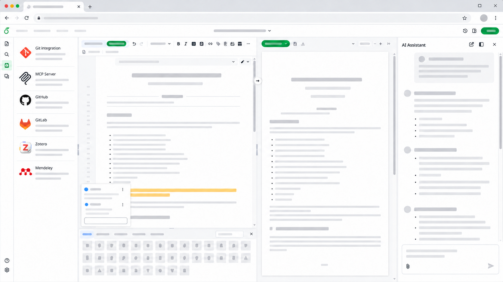

<h1 align="center">
  <br>
  <a href="https://ayakaleaf-pro.ayaka.space"></a>
</h1>

<h4 align="center">Overleaf Community Edition enhanced with all Pro features <br/>(open source, free to use, self-hostable).</h4>

<p align="center">
  <a href="https://ayakaleaf-pro.ayaka.space">Documents</a> •
  <a href="https://github.com/ayaka-notes/ayakaleaf-pro-playground">Playground</a> •
  <a href="https://ayakaleaf-pro.ayaka.space/blog">Blog</a> •
  <a href="https://github.com/orgs/ayaka-notes/packages/container/package/overleaf-pro">Docker Image</a> •
  <a href="https://github.com/ayaka-notes/texlive-full">TeXLive</a> •
  <a href="https://ayakaleaf-pro.ayaka.space/dev">Developer</a> •
  <a href="#authors">Authors</a> •
  <a href="#license">License</a>
</p>


<p align="center">
  Figure 1: A screenshot of a project being edited in Ayakaleaf Pro Edition.
</p>

## Ayakaleaf Pro Edition
Ayakaleaf Pro is an enhanced version of Overleaf with almost all features and capabilities. For details, please check [Ayakaleaf Pro](https://ayakaleaf-pro.ayaka.space) page. Features in Ayakaleaf Pro include: 

- MCP Server (Let AI Agents Edit, Compile and Comment)
- AI Chat Assistant (Chat, Edit and Fix with AI)
- Error Assistant (Explain and Fix Compile Errors)
- Pandoc Import/Export (Convert Word, Markdown and LaTeX)
- Python Script Runner (Run Python in Your Project)
- 2-way GitHub(Enterprise) Sync (Push and Pull with GitHub)
- 2-way GitLab Sync (GitLab.com or Self-hosted GitLab)
- Zotero Integration(With Zotero OAuth Support)
- Mendeley Integration(With Mendeley OAuth Support)
- Advanced Reference Search (Search All Your Bib Entries)
- Git-Bridge Support (Clone, Pull and Push with Git)
- Admin Panel (Global Users/Projects management)
- SSO with LDAP and SAML or OAuth 2.0
- Unlimited Compile Times (Adjustable in admin panel)
- Self Register (Optional, can be limited by mail domain)
- Sandbox Compile (With [texlive-full](https://github.com/ayaka-notes/texlive-full) image support)
- Template System (With Template Gallery)
- Track Changes (With Review and Comment Panel)
- Full Project History(With Restore and Download)
- Symbol Palette (Insert Math Symbols in One Click)
- ARM Support(x86_64/arm64 on Docker)

Last but not least, Ayakaleaf Pro is open-source, free to use and modify. You can self-host it and contribute to the development of Ayakaleaf Pro. For more details, please check [Developer Documentation](https://ayakaleaf-pro.ayaka.space/dev) page.

> [!NOTE]
> Note: Ayakaleaf Pro is not affiliated with Overleaf, Inc. or its parent company, Digital Science. It is also *not Server Pro* Edition, which is a commercial product offered by Overleaf, Inc.
> 
> Ayakaleaf Pro is an independent project developed and maintained by the [ayaka-notes](https://github.com/ayaka-notes).

## Installation

If you just want to try Ayakaleaf Pro without setting up a server, you can use our [Ayakaleaf Pro Playground](https://github.com/ayaka-notes/ayakaleaf-pro-playground). It provides a preconfigured GitHub Codespaces environment that lets you launch and explore Ayakaleaf Pro directly in your browser.

[](https://codespaces.new/ayaka-notes/ayakaleaf-pro-playground)

If you want to deploy Ayakaleaf Pro for production use,  we have detailed installation instructions on the [Documents](https://ayakaleaf-pro.ayaka.space/) page. We highly recommend installing Ayakaleaf Pro using the [ayaka-notes/Toolkit](https://github.com/ayaka-notes/toolkit/).

## Lab deployment (this fork)

This fork adds a documented, reproducible self-hosted deployment wired to an
OpenAI-compatible LLM gateway. The app itself is the unmodified upstream image.
Details: [docs/LLM_INTEGRATION.md](docs/LLM_INTEGRATION.md), [docs/TESTING.md](docs/TESTING.md).

**What runs:** [`ayaka-notes/toolkit`](https://github.com/ayaka-notes/toolkit) with
`SERVER_PRO=true` → image `ghcr.io/ayaka-notes/overleaf-pro:6.3.0`, plus `mongo:8.0` and
`redis:7.4`. Compiles run sandboxed in per-project `ghcr.io/ayaka-notes/texlive-full:2026.1`
sibling containers. The repository's own root `docker-compose.yml` is the stock Overleaf CE
example (`sharelatex/sharelatex`) and is **not** used.

### Setup

Requirements: Docker + Compose v2, ~35 GB free disk (the TeX Live image alone is ~29 GB), 4 GB+ RAM.

```bash
git clone https://github.com/ayaka-notes/toolkit.git ~/ayakaleaf-toolkit
cd ~/ayakaleaf-toolkit && bin/init
sed -i 's/^SERVER_PRO=false/SERVER_PRO=true/' config/overleaf.rc
# in config/variables.env set:
#   TEX_LIVE_DOCKER_IMAGE=ghcr.io/ayaka-notes/texlive-full:2026.1
#   ALL_TEX_LIVE_DOCKER_IMAGES=ghcr.io/ayaka-notes/texlive-full:2026.1

# AI settings + secret key: ONE git-ignored file at this repo's root
cp ~/ayakaleaf-pro/.env.example ~/ayakaleaf-pro/.env   # then set AI_API_KEY
chmod 600 ~/ayakaleaf-pro/.env
cp ~/ayakaleaf-pro/deploy/toolkit-override.example.yml config/docker-compose.override.yml
chmod 600 config/variables.env config/docker-compose.override.yml
```

### Start / stop / logs

```bash
cd ~/ayakaleaf-toolkit
bin/up -d                    # start (first run pulls ~30 GB of images)
bin/stop                     # stop, keep containers
bin/start                    # start stopped containers
bin/docker-compose down      # remove containers (data is kept in data/)
bin/logs -f web              # app logs (also: clsi, real-time, document-updater, ...)
docker logs -f sharelatex    # container stdout
bin/doctor                   # environment diagnostics
```

The UI is served on the internal network at **http://10.110.188.149:8001/** (`OVERLEAF_PORT=8001`, `OVERLEAF_LISTEN_IP=0.0.0.0` in `config/overleaf.rc`; `OVERLEAF_SITE_URL=http://10.110.188.149:8001` in `config/variables.env`). Plain HTTP: for anything beyond internal testing, use TLS.
From another machine use an SSH tunnel (`ssh -L 8001:127.0.0.1:8001 <host>`), or put a TLS
proxy in front (`bin/init --tls`) rather than exposing port 80. Create the first admin at
`/launchpad`; manage users at `/admin`.

After editing `.env` or `config/*`, apply with `bin/docker-compose up -d sharelatex`.

Data lives in `~/ayakaleaf-toolkit/data/{overleaf,mongo,redis}`. Back up all three.

### Usage

Create a project from the dashboard, edit, and press **Recompile**; download the PDF or
**Menu → Download → Source (zip)**. With AI configured, the editor shows the AI chat
panel and a **Suggest fix** button on compile errors (Error Assistant). The chat's
editing tools run in the browser, and every `replace_lines` edit is shown as a diff that
the user must approve.

### Troubleshooting

| Symptom | Cause / fix |
|---|---|
| `bin/up` hangs before starting containers | It pulls the ~29 GB TeX Live image first. Pull it separately (`docker pull ghcr.io/ayaka-notes/texlive-full:2026.1`) or run `SIBLING_CONTAINERS_PULL=false bin/up -d`. |
| AI chat: "The AI service returned an error" | Check `bin/logs web \| grep -iE "tex-gpt\|suggest-fix"`. `budget_exceeded` (HTTP 429) means the gateway key's spend limit is reached; ask the gateway admin. |
| AI panel missing / `403 ai_not_configured` | `AI_ENABLED`, `AI_BASE_URL`, `AI_API_KEY`, `AI_MODEL` must all be set in the container: `docker exec sharelatex sh -c 'echo ${#AI_API_KEY}'` should print a non-zero length. |
| `403 ai_access_denied` | An admin disabled AI for that user (`aiFeatures.enabled=false`). |
| Compile fails with Docker errors | Docker socket must be mounted (`SIBLING_CONTAINERS_ENABLED=true`) and the TeX Live image present locally. |
| Page not reachable from other machines (`ERR_CONNECTION_REFUSED`) | Check `docker port sharelatex`: `127.0.0.1:8001` means it is bound to loopback only. Set `OVERLEAF_LISTEN_IP=0.0.0.0`, then `bin/docker-compose up -d sharelatex`. A timeout instead of a refusal points to a network firewall. |
| Port already in use | Change `OVERLEAF_PORT` in `config/overleaf.rc` (this deployment uses 8001), then `bin/docker-compose up -d sharelatex`. |

## Upgrading

If you are upgrading from a previous version of Ayakaleaf Pro, please see the [Releases page](https://github.com/ayaka-notes/overleaf-pro/releases) for the changes in each version between your current version and the one you are upgrading to.

## Translations

We welcome contributions to translations of Ayakaleaf Pro. Generally, we use claude/codex to translate the English text into other languages. If you find any errors in the translations, please submit a pull request to fix them. Please only modify relevant files in the `services/web/locales/locales_patches` folder.

Files under `services/web/locales/` are overleaf official translation files. Please do not modify them directly.

## Contributing

Please see the [CONTRIBUTING](CONTRIBUTING.md) file for information on contributing to the development of Overleaf.

## Blog
We write about Overleaf internals, compilation performance, and self-hosted LaTeX infrastructure. Read more on our blog:
- [2026.08 Overleaf Server Pro Price and Open-Source Alternative](https://ayakaleaf-pro.ayaka.space/blog/2026/overleaf-server-pro-price-and-open-source-alternative)
- [2026.08 Overleaf Benchmark: A Deep Research of Concurrent LaTeX Compilation in Overleaf](https://ayakaleaf-pro.ayaka.space/blog/2026/overleaf-benchmark)

## Authors

- [The Overleaf Team](https://www.overleaf.com/about)
- [Features and Copyright](https://ayakaleaf-pro.ayaka.space/on-premises/readme/features-and-copyright)

## License

The code in this repository is released under the GNU AFFERO GENERAL PUBLIC LICENSE, version 3. A copy can be found in the [`LICENSE`](LICENSE) file.

- Copyright (c) Overleaf, 2014-2025.
- Copyright (c) [Pro Authors](https://ayakaleaf-pro.ayaka.space/on-premises/readme/features-and-copyright), 2026-now.

## Sponsor
- [OpenAI Codex OSS](https://openai.com/en/form/codex-for-oss/)
- [GitBook](https://www.gitbook.com/)

## Star History

<a href="https://www.star-history.com/?repos=ayaka-notes%2Fayakaleaf-pro&type=date&legend=top-left">
 <picture>
   <source media="(prefers-color-scheme: dark)" srcset="https://api.star-history.com/chart?repos=ayaka-notes/ayakaleaf-pro&type=date&theme=dark&legend=top-left&sealed_token=u3l5zBKFPuzl3y_xdCmqTPT_5iaimMLJchJaALvNsAR3LtSu2NrnvjlmbfGW1NdyDch3XLj-o6rfTpyk2K7s6gtgdzDvrDAsTkBnGz_m2CAkbq0IvxsFXPzEkypDT3vhHvYsvDu3qd7Dx6LcPFy_330a0kqmByAl6FKN-13QCGuo1LTv0iEUihWDTUlz" />
   <source media="(prefers-color-scheme: light)" srcset="https://api.star-history.com/chart?repos=ayaka-notes/ayakaleaf-pro&type=date&legend=top-left&sealed_token=u3l5zBKFPuzl3y_xdCmqTPT_5iaimMLJchJaALvNsAR3LtSu2NrnvjlmbfGW1NdyDch3XLj-o6rfTpyk2K7s6gtgdzDvrDAsTkBnGz_m2CAkbq0IvxsFXPzEkypDT3vhHvYsvDu3qd7Dx6LcPFy_330a0kqmByAl6FKN-13QCGuo1LTv0iEUihWDTUlz" />
   
 </picture>
</a>
